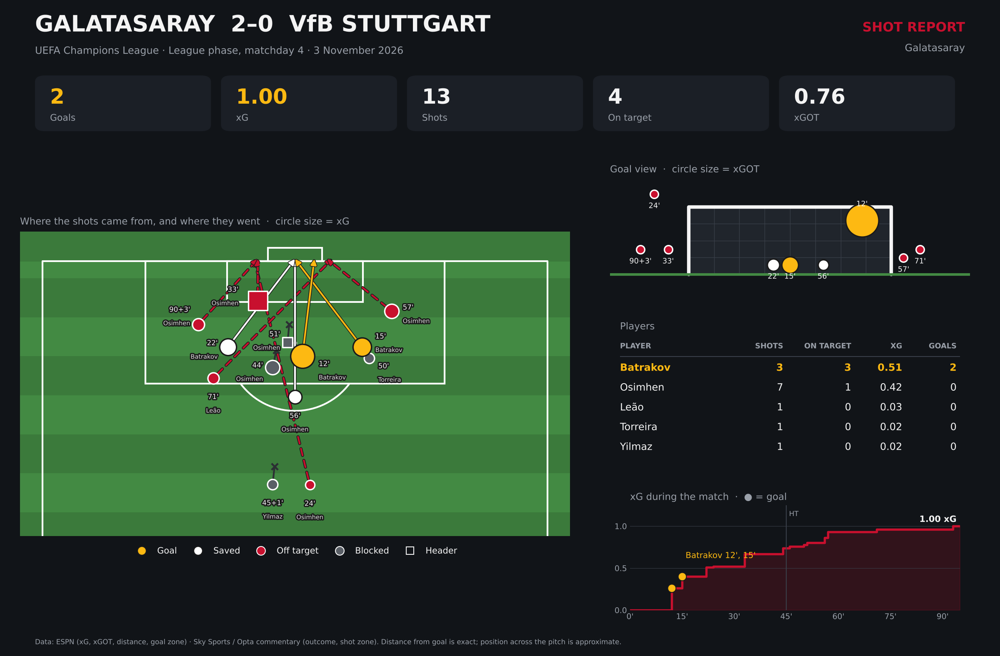

# Galatasaray 2–0 VfB Stuttgart: Shot Report

A post-match shot report for Galatasaray's 2–0 win over VfB Stuttgart in the UEFA Champions League (league phase, matchday 4, 3 November 2026), built with Python and matplotlib.



## What the report shows

- **Shot map:** where each of Galatasaray's 13 shots was taken from, with an arrow to where the ball went. Circle size is the shot's xG, and squares are headers.
- **Goal view:** where shots ended up relative to the goal frame. For shots on target, circle size is xGOT.
- **Player table:** shots, shots on target, xG and goals for each player.
- **xG during the match:** cumulative xG over 90 minutes, with the two goals marked.

## Key numbers

| Goals | xG | Shots | On target | xGOT |
|---|---|---|---|---|
| 2 | 1.00 | 13 | 4 | 0.76 |

Both goals came from Aleksey Batrakov in the first 15 minutes (0.40 xG combined). Victor Osimhen took 7 of the 13 shots but none of them went in.

## Data

I collected the data by hand from two public sources:

- **ESPN match page:** xG, xGOT, distance from goal and goal-mouth zone for each shot
- **Sky Sports live commentary (Opta):** shot outcome (goal, saved, off target, blocked) and the zone each shot was taken from, e.g. "right side of the box"

Neither source gives exact x/y coordinates. Each shot is placed at its real distance from goal, on the side of the pitch the commentary describes, so the positions are close but not exact. If you have exact coordinates, change the `side_m` values in `SHOTS` at the top of `shot_report.py`.

## How to run

```bash
pip install -r requirements.txt
python shot_report.py
```

The image is saved as `galatasaray_shot_report.png`.

You can also run it in [Google Colab](https://colab.research.google.com) without installing anything: create a new notebook, paste in the contents of `shot_report.py` and run the cell.

## Built with

Python 3, matplotlib
